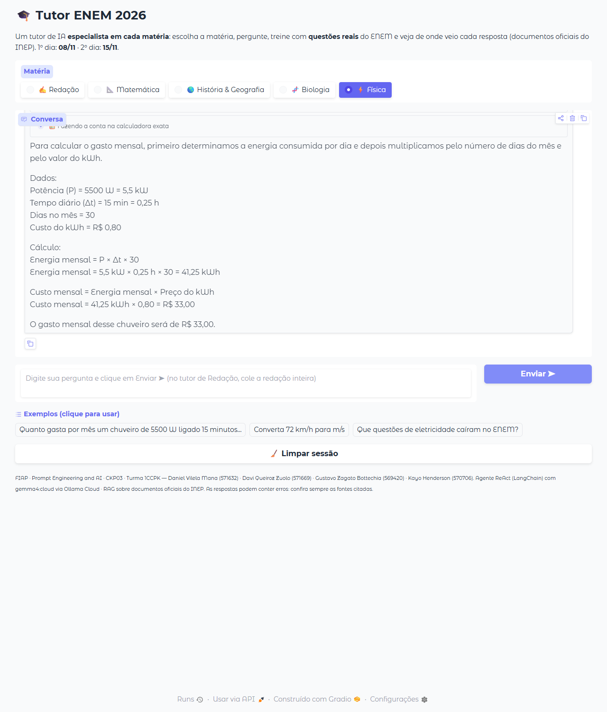
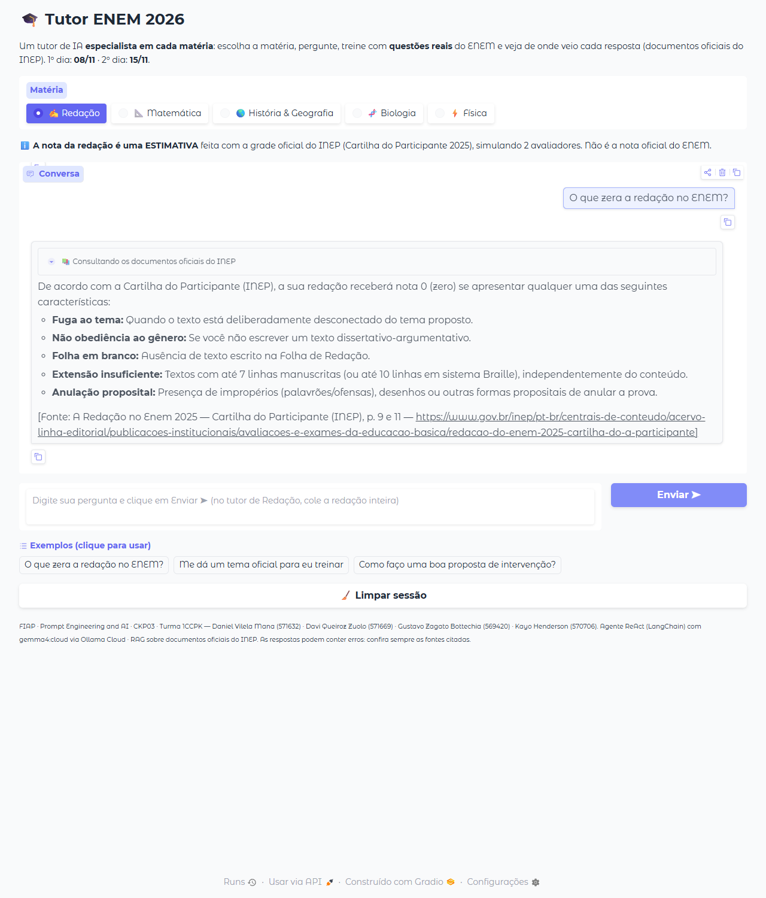
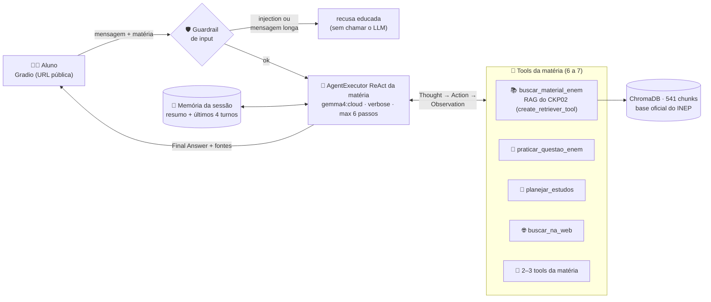

# 🎓 Tutor ENEM 2026 — Agente Inteligente (CKP03)

**FIAP · Prompt Engineering and Artificial Intelligence · 2º semestre · Checkpoint 03** — Prof. Jorge Luiz Gomes · Turma 1CCPK

Um tutor de IA para o **ENEM 2026** (provas em 8/11 e 15/11/2026) com **um agente especialista por matéria** —
✍️ Redação · 📐 Matemática · 🌎 História & Geografia · 🧬 Biologia · ⚡ Física. Cada agente é um **ReAct**
(`create_react_agent` + `AgentExecutor`, LangChain) com o modelo **`gemma4:cloud` via Ollama Cloud**, que decide sozinho
quando consultar os **documentos oficiais do INEP** (RAG do CKP02 como tool), quando usar uma ferramenta de cálculo ou
de treino e quando responder direto. O aluno conversa por uma **interface Gradio** com URL pública.

## 👥 Integrantes

| Integrante | RM |
|---|---|
| Daniel Vilela Mana | 571632 |
| Davi Queiroz Zuolo (líder) | 571669 |
| Gustavo Zagato Bottechia | 569420 |
| Kayo Henderson | 570706 |

## 🔗 Entrega

| Item | Link |
|---|---|
| Notebook no Colab (leitura) | [Abrir no Colab](https://colab.research.google.com/github/DaviZuolo07/Agente_Inteligente/blob/main/CKP03_TutorENEM_1CCPK.ipynb) |
| Notebook executado (`.ipynb`, com as saídas) | [`CKP03_TutorENEM_1CCPK.ipynb`](CKP03_TutorENEM_1CCPK.ipynb) |
| URL pública do Gradio (ativa no dia da correção) | **`https://________________.gradio.live`** ← preencher com a URL do Run All do dia da entrega |
| Vídeo da URL pública ativa | `docs/assets/` ← adicionar o vídeo gravado no dia da entrega |
| Como funciona (implementação) | [`docs/IMPLEMENTACAO.md`](docs/IMPLEMENTACAO.md) |
| Auditoria (enunciado e rubrica × evidência) | [`docs/AUDITORIA.md`](docs/AUDITORIA.md) |
| Checklist e mensagem de entrega | [`docs/ENTREGA.md`](docs/ENTREGA.md) |

## 🖼️ A interface funcionando (URL pública)

Prints feitos pela URL pública `https://….gradio.live` durante os testes (28/10/2026). Cada tool que o agente usa
aparece como um passo recolhível, e a resposta final cita a fonte.

| ⚡ Física — conta exata com a calculadora | ✍️ Redação — RAG citando a Cartilha do INEP |
|---|---|
|  |  |

## ▶️ Como rodar

**No Google Colab (forma da entrega)**
1. Crie uma chave gratuita em <https://ollama.com> (*Settings → API keys*).
2. No Colab, ícone 🔑 **Secrets** → *Add new secret* → nome **`OLLAMA_API_KEY`** → cole a chave → ative o acesso ao notebook.
   A chave **nunca** aparece no código: o notebook lê com `userdata.get("OLLAMA_API_KEY")`.
3. *Runtime → Run all*. O notebook clona este repositório (documentos e dados), sobe um Ollama local só para os
   embeddings (`nomic-embed-text`), indexa a base no ChromaDB, testa as tools, monta os agentes e publica a interface.
4. A última célula imprime a **URL pública** (`https://….gradio.live`). Ela fica no ar enquanto a sessão do Colab estiver ativa.

**Fora do Colab (testes do grupo, opcional):** com o [Ollama](https://ollama.com/download) instalado e logado
(`ollama signin`) e o `nomic-embed-text` baixado, rode o notebook de dentro da pasta do repositório com a variável
`TUTOR_ENEM_LOCAL=1`. O Ollama da máquina encaminha o mesmo `gemma4:cloud` para o Ollama Cloud.

## 🏗️ Arquitetura



**RAG (Seções 3–6).** Base 100% oficial do INEP: Matriz de Referência e Cartilha da Redação 2025 (texto por OCR,
porque os PDFs têm fonte sem mapeamento Unicode), Edital nº 64/2026, propostas de redação 2024–2025 e **186 questões
reais** das provas de 2024 e 2025 com gabarito oficial. Chunks de 1024/128 (configuração vencedora do RAGAS no CKP02),
ChromaDB com metadado `materia`. A tool faz **busca híbrida** (vetorial + BM25) filtrada pela matéria, **expansão da
consulta** pelo `gemma4:cloud` ("zera" → "nota zero") e **reranking multilíngue** (`mmarco-mMiniLMv2`); cada trecho chega
ao agente com `[Fonte: título, página — link]`.

## 🧰 As 14 tools

| Tool | Agentes | O que faz |
|---|---|---|
| `buscar_material_enem` | todos | **RAG do CKP02** via `create_retriever_tool()`: documentos oficiais do INEP, com fonte e página |
| `praticar_questao_enem` | todos | sorteia **questão real** do ENEM sem gabarito e corrige a letra pelo **gabarito oficial** (Redação: tema oficial, inédito ou do aluno) |
| `planejar_estudos` | todos | cronograma até a prova da matéria, pelos blocos da Matriz de Referência |
| `buscar_na_web` | todos | Wikipédia PT, com compressão da Observation acima de 500 caracteres |
| `analisar_estrutura_redacao` | Redação | parágrafos, linhas, cópia dos motivadores, conectivos e os 5 elementos da proposta de intervenção |
| `corrigir_redacao` | Redação | nota estimada com a **grade oficial** (5 competências × 6 níveis), 2 avaliadores + 3º na discrepância |
| `calcular` | Matemática, Física | calculadora **exata** (SymPy, sem `eval`): expressões, equações, combinatória, juros; na Física, com as constantes do ENEM |
| `estatistica_descritiva` | Matemática | média, mediana, moda, amplitude, variância e desvio (populacional e amostral) |
| `como_digitar` | Matemática | guia "do caderno para o teclado" + formulário, com exemplos conferidos |
| `formulario_fisica` | Física | fórmulas por assunto da Matriz, constantes e conversão exata de unidades |
| `cruzamento_genetico` | Biologia | quadro de Punnett e proporções (mono/di/tri-híbrido, dominância incompleta, ABO, ligada ao X) |
| `traduzir_dna` | Biologia | DNA → RNAm → aminoácidos com a tabela completa dos 64 códons |
| `calcular_fuso_horario` | História & Geografia | regra do ENEM (15° = 1 h), hora legal e solar, mudança de data |
| `escala_cartografica` | História & Geografia | E = D/d nos três sentidos e áreas (E²) |

Toda description segue 4 partes comentadas no código: **o que faz · quando usar (com exemplos) · formato do Action
Input e da saída · quando NÃO usar** (apontando a tool certa).

## ✅ Diferenciais implementados

- **Guardrail de input** (Seção 9): 1ª camada em código bloqueia *prompt injection* explícita e mensagens longas sem
  chamar o LLM; 2ª camada no prompt recusa perguntas fora da matéria e injeção disfarçada. Testado com 11 ataques e 8
  mensagens legítimas parecidas (0 falso positivo).
- **Compressão de contexto** (Aula 10): memória por sessão com **resumo + janela deslizante** dos últimos 4 turnos;
  Observations da web resumidas pelo LLM acima de 500 caracteres.
- **Mais de 3 tools:** 6 por agente (7 na Matemática), 14 no total.

## 🧪 Evidências no notebook

| O quê | Onde | Resultado registrado |
|---|---|---|
| Teste isolado de cada tool com `invoke()` | 6.1 e 7.11 | RAG nas 5 matérias sem vazamento de matéria; 70 testes de 13 tools (casos conhecidos + caso de erro) |
| Guardrail com tentativa de injection | 9.1 | 11/11 ataques bloqueados, 8/8 mensagens legítimas liberadas |
| 3 interações (RAG · outra tool · sem tool) + multi-step | 10.1–10.4 | logs `verbose`, checagens automáticas e nota 0,0–1,0 (LLM-juiz) |
| Simulação das 6 perguntas do professor | 10.5 | tool escolhida × esperada para 2 RAG, 2 outra tool, 2 sem tool |

## 📁 Estrutura do repositório

```
CKP03_TutorENEM_1CCPK.ipynb   notebook da entrega (executado, com as saídas)
fontes.csv                    manifesto da base: título, tipo, matéria, data e link oficial de cada documento
docs/                         documentos oficiais do INEP (PDFs) e as versões em texto (.md) usadas no RAG
docs/assets/                  prints da interface
docs/IMPLEMENTACAO.md         como o sistema funciona, seção por seção
docs/AUDITORIA.md             enunciado e rubrica do CKP03 × evidência no notebook
docs/ENTREGA.md               checklist do dia da entrega e mensagem para o Teams
dados/                        banco de 186 questões, grade da redação, temas, dicionário de Matemática, formulário de Física
scripts/                      geração dos dados a partir dos PDFs oficiais (OCR, extração de questões)
```

---
<sub>As respostas do tutor podem conter erros e a nota da redação é uma estimativa: confira sempre as fontes citadas.
Documentos oficiais © INEP/MEC, usados para fins educacionais.</sub>
